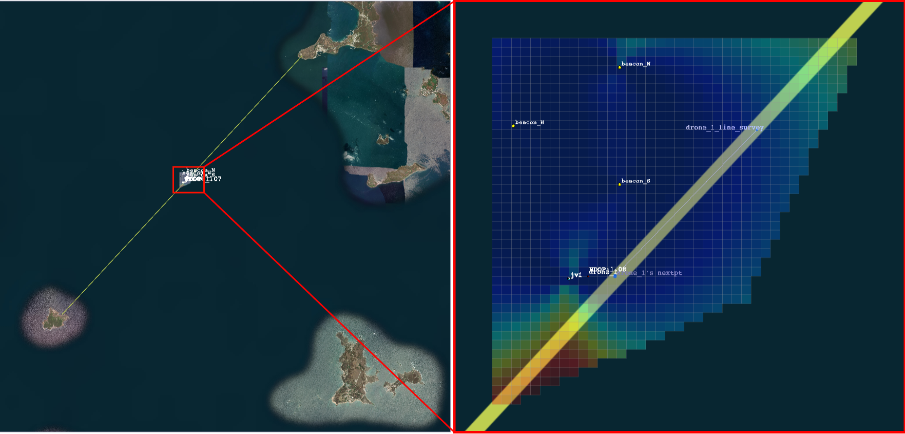
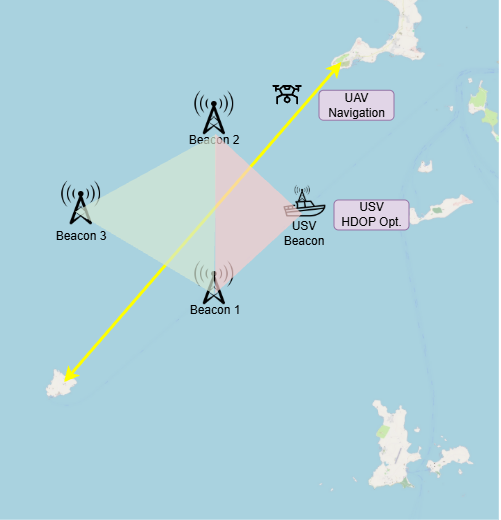
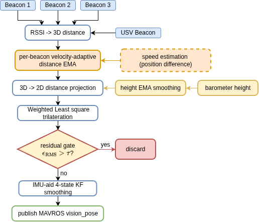
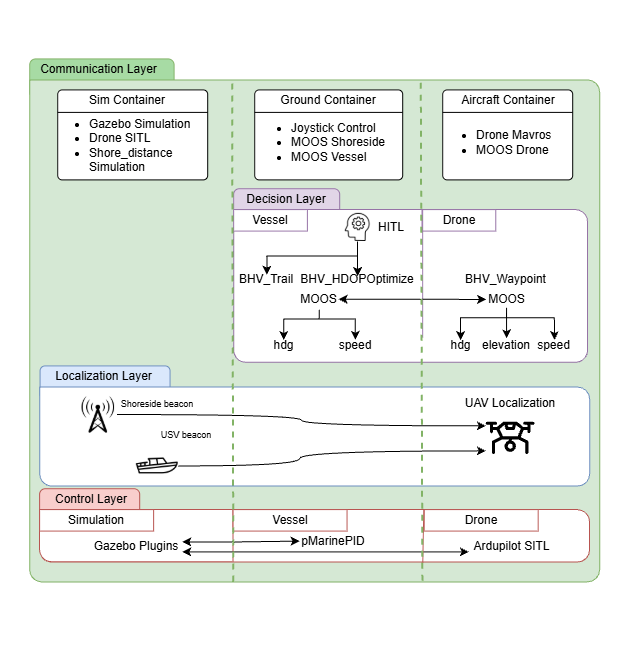
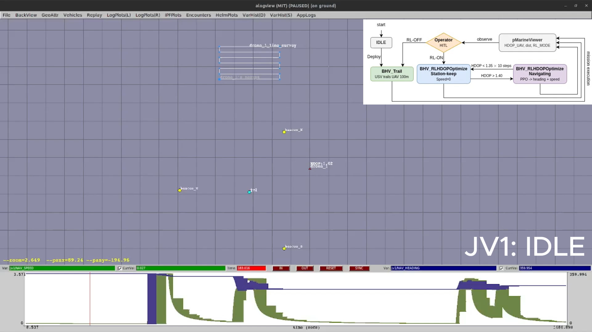

# RSSI-Based GPS-Denied UAV Localization with RL-Driven USV Geometric Optimization

**M.S. thesis project** · National Yang Ming Chiao Tung University (NYCU), Institute of Electrical and Control Engineering · Advisor: Prof. Hsueh-Cheng Wang · Dec 2025 – Aug 2026 · [📄 Thesis](https://thesis.lib.nycu.edu.tw/items/641c364e-b297-47e4-8ace-23b657a1e038)

> A UAV flies point-to-point over open sea with **no GPS**. It localizes itself from shore-beacon **RSSI** fused with its **IMU**, while a **USV trained with PPO** acts as a mobile beacon that repositions itself to keep the beacon geometry (HDOP) favorable.

<p align="center">
  
</p>

> **About the code:** this is a showcase repository. The implementation lives in a private research repository built on lab infrastructure (ARG-NCTU), so the source is not published here. Code walkthroughs are available on request.

---

## Problem

Maritime search-and-rescue and monitoring increasingly pair UAVs with USVs. The UAV mission I study runs between **Xiyu and Huayu islands (Penghu, Taiwan)**, where GPS may be lost to jamming, terrain, or other interference.

- **Open sea defeats SLAM:** the water surface is feature-sparse, so vision and LiDAR odometry have little to track.
- **RSSI is cheap but fragile:** RF ranging works in any weather and fits a small UAV's size, weight, and power (SWaP) budget. However, log-distance path loss makes the ranges noisy, and the error grows with distance.
- **Geometry degrades during flight:** as the UAV moves, its geometry relative to fixed beacons changes. When the beacons become nearly collinear from the UAV's viewpoint (high **HDOP**), the position fix degrades even if every range is good.

<p align="center">
  
</p>

## Approach

### 1. RSSI + IMU localization front-end

<p align="center">
  
</p>

- RSSI → 3D range per beacon, then **velocity-adaptive EMA** smoothing
- Barometer-based **height projection** from 3D to 2D ranges
- **Weighted least-squares trilateration** with weights `w_i ∝ 1/d_i²`, which limits the exponential error amplification of far beacons
- **Residual gating**: fixes whose RMS residual exceeds the threshold are discarded
- A **4-state Kalman filter** with high-rate IMU prediction, published to the flight controller as `vision_pose`

### 2. Geometry-aware measurement noise (main contribution)

Existing RSSI noise models capture only distance-dependent uncertainty. I added beacon geometry to the measurement noise:

```
σ_pos(t) = k_d · d̄(t) · HDOP(t)  +  k_R · max(0, ε_RMS(t) − ε_floor)
R_t      = σ_pos(t)² · I₂
```

With this term, the filter automatically trusts RSSI fixes less when the geometry is poor.

### 3. QP velocity projection (robustness)

When `σ_pos > 2.0 m`, a small quadratic program projects the KF velocity onto physically feasible values. It enforces a speed bound, body-frame forward/reverse limits, and an acceleration bound between RSSI updates.

### 4. PPO mobile beacon (USV)

The USV is trained with **PPO** to reposition itself during the UAV mission and keep HDOP low.

- **Observation (16-D):** USV speed; UAV range/bearing/radial and tangential velocity relative to the USV; range/bearing to each fixed beacon; current HDOP
- **Action:** heading and speed in `[-1, 1]²`
- **Reward:** potential-based HDOP improvement, ranging-distance shaping, a stagnation penalty, a cluster-bearing geometry term, and a terminal geometry reward
- **5-stage curriculum** (4M steps per stage): static UAV with basic, medium, and extreme geometry → lawnmower-pattern UAV → added random walk

## System architecture

<p align="center">
  
</p>

- **Communication:** separate Docker containers for simulation, ground station, and aircraft, mirroring a real deployment; ROS 2 + Zenoh
- **Decision:** **MOOS-IvP** as the backseat driver with custom behaviors (`BHV_Trail`, `BHV_RLHDOPOptimize`, `BHV_Waypoint`)
- **Control:** ArduPilot SITL for the UAV; `pMarinePID` for the USV
- **Human-in-the-loop:** an operator switches the USV between trailing and RL mode. Inside RL mode, the USV switches between *station-keep* and *navigate* with HDOP hysteresis.

<p align="center">
  
</p>

## Results (Gazebo + VRX + MOOS-IvP + ArduPilot SITL)

**Localization ablation**

| Condition | Mean ± Std (m) | RMSE (m) | Max (m) | ΔRMSE |
|---|---|---|---|---|
| Prior-work baseline | 1.874 ± 0.917 | 2.086 | 5.747 | — |
| + IMU dead-reckoning prediction | 1.367 ± 0.644 | 1.511 | 4.597 | −27.6 % |
| + distance awareness | 1.106 ± 0.505 | 1.216 | 3.462 | −41.7 % |
| **Proposed method** | **0.622 ± 0.348** | **0.713** | **2.282** | **−65.8 %** |
| *Simulated GPS (reference)* | *1.168 ± 0.186* | *1.182* | *1.594* | |

**Geometry-aware noise across flight lines.** The proposed method lowered RMSE by **33.7–46.3 %** compared with a fixed-R baseline (e.g. 1.729 → 0.929 m on the farthest line).

**QP velocity projection.** 2D RMSE fell from 1.095 to 0.981 m (**−10.5 %**).

**PPO mobile beacon.** Across 8 approach directions, the USV kept HDOP below the target for **89.5 %** of the time, compared with **63.3 %** for a trailing baseline (`BHV_Trail`). Mean HDOP during station-keeping was 1.14 (baseline 1.31).

## Tech stack

`ROS 2` · `Gazebo` · `VRX` · `MOOS-IvP` · `ArduPilot SITL` / `MAVROS` · `Python` · `C++` · `Gymnasium` · `Stable-Baselines3 (PPO)` · `Docker` · `Zenoh`

## My role

I did all of the work in this project: problem formulation, the localization pipeline, the geometry-aware noise model, the QP projection, the Gymnasium environment and PPO training, the MOOS-IvP behaviors and HITL integration, the containerized simulation setup, and the experiments. It was built on the lab's simulation and vehicle infrastructure.

## Links

- 📄 Thesis (in Chinese, English abstract): [NYCU Thesis Repository](https://thesis.lib.nycu.edu.tw/items/641c364e-b297-47e4-8ace-23b657a1e038)
- 🎥 Demo video: *add a YouTube link*
- 📧 Contact: charles92421@gmail.com
